# Real Estate Platform — CRM & operations

**Case study 01 · Real Estate Platform · CRM & operations** · live since the 9 Sep 2026 cutover · [Live site: rentaroof.in](https://rentaroof.in) · [Interactive demo](https://abbytes-sudo.github.io/real-estate-crm-showcase/)

### A Delhi property brokerage moved off spreadsheets and a *12-seat subscription CRM* onto a *self-hosted CRM and website* the team now runs on, in 3 months (Jun–Sep 2026).

**Status:** live since the 9 Sep 2026 production cutover and in daily use by the brokerage's team. Live site: [rentaroof.in](https://rentaroof.in) (the CRM sits behind a staff login).

**My role:** Operations & CRM lead. Designed and delivered, AI-assisted: I gathered the requirements, made the product decisions, directed AI coding tools and tested every change, then ran the data migration, go-live and team training.

| Role | Live | Demo | Stack |
|---|---|---|---|
| Operations & CRM lead · AI-assisted build | [rentaroof.in](https://rentaroof.in) | [Interactive demo](https://abbytes-sudo.github.io/real-estate-crm-showcase/) (click through the screens) | Laravel · Filament · Livewire · MySQL · self-hosted |

| **9 Sep** | **113** | **2,397** |
|---|---|---|
| 2026 production cutover, 3 months after work began | organic leads (not paid ads) of 383 new, 9 Sep–23 Oct 2026 | tasks completed in the 30 days to 22 Oct 2026 |

> **Case study PDF.** This page tells the same story as my 36-page PDF case study, *Real Estate Platform — CRM & operations*, chapter for chapter (01–09 below, then Results and My role), with more screens. The PDF itself is not in this repo; ask for it through the contact details on my [GitHub profile](https://github.com/abBytes-sudo).

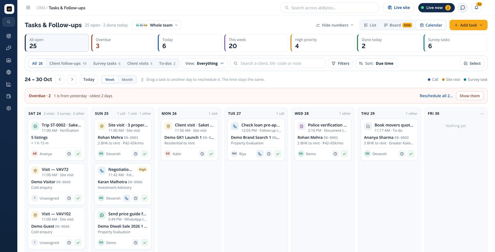

*Tasks calendar: calls, site visits and listing checks for the week, dragged to reschedule (demo data).*

  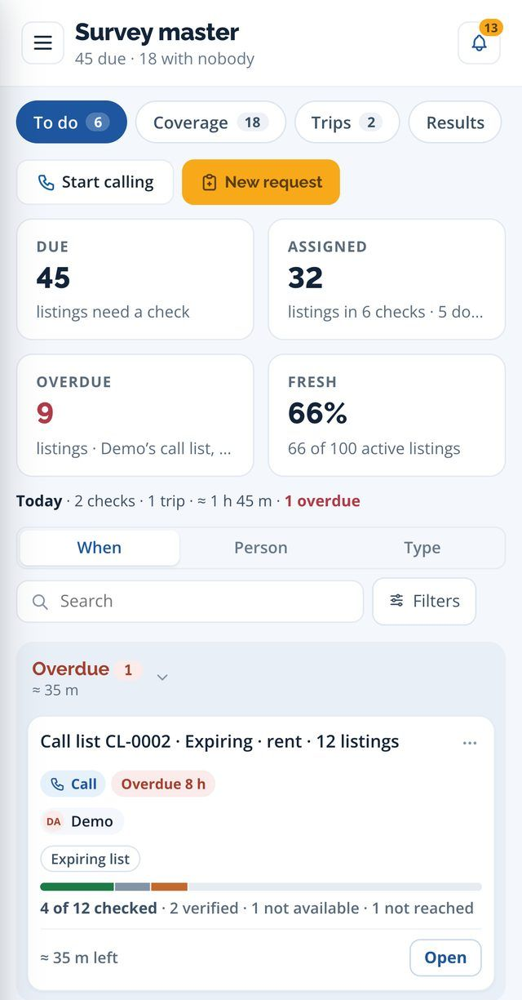 
  <em>The listing verification desk on the phone (demo data).</em>

*About the screenshots:* screens are from a white-labelled demo copy: "abBytes" is a placeholder brand, not a real company, and the people, listings, addresses and figures on screen are fictional demo data, with phone numbers masked. Layouts and flows match production. The only production numbers are the dated ones in this write-up. The source is in a private repo; walkthrough on request.

---

**Contents:** [01 The starting point](#01--the-starting-point) · [The system](#the-system) · [The switch](#the-switch) · [02 Inventory in](#02--inventory-in) · [03 Listing verification](#03--listing-verification) · [04 People & calling](#04--people--calling) · [Calling sessions](#calling-sessions) · [Deploying calling work](#deploying-calling-work-without-spreadsheets) · [Telephony & messaging](#telephony-and-messaging-built-in) · [05 Clients & matching](#05--clients--matching) · [06 Where the leads come from](#06--where-the-leads-come-from) · [07 Deals & dues](#07--deals--dues) · [08 Website & Roofie](#08--website--roofie) · [09 Admin & data](#09--admin--data) · [Results](#results) · [My role](#my-role--how-it-was-built) · [More screens](#more-screens-the-full-screen-tour)

---

## 01 · The starting point

### Leads in a rented CRM. Listings in spreadsheets. New stock in *two printed magazines.*

| A 12-seat subscription CRM | Listings in spreadsheets | Two monthly print magazines |
|---|---|---|
| **≈ ₹1.44 L a year** in seat fees (12 seats × ₹1,000 a month), with the brokerage's lead records and their history held in the vendor's system. | Inventory sat in workbooks, apart from the leads. The first load into the new system (2026) brought across **8,541 listings and 3,237 photos.** | Two listing magazines (A and B) arrive each month as PDFs. Each issue used to go PDF → Word → a desktop parser → Excel fixes by hand. The **Sept 2026 issues ran to 10,639 printed lines.** |

**→ The brief:** one system the brokerage owns, with inventory, leads, tasks and the website in one place, instead of seats it rents.

---

## The system

### One self-hosted CRM. *Six parts that feed each other.*

**7,758** URLs in the public sitemap on 23 Oct 2026, built from CRM data (6,840 of them listing pages) and refreshed daily.

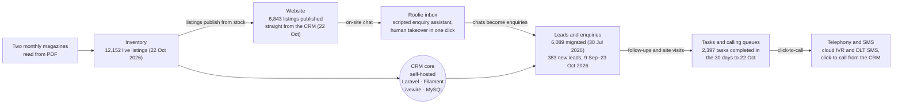

**Inventory matched to leads:** new listings scored against open briefs nightly.

| Part | What it holds |
|---|---|
| Inventory | 12,152 live listings (22 Oct 2026), fed by two monthly magazines read from PDF |
| Website | 6,843 listings published straight from the CRM (22 Oct) |
| Roofie inbox | Scripted enquiry assistant, human takeover in one click |
| Leads & enquiries | 6,089 migrated (30 Jul 2026); 383 new leads, 9 Sep–23 Oct 2026 |
| Tasks & calling queues | 2,397 tasks completed in the 30 days to 22 Oct |
| Telephony & SMS | Cloud IVR and DLT SMS, click-to-call from the CRM |

---

## The switch

### Jun to Sep 2026: built, migrated, *switched over.*

| When | What happened |
|---|---|
| Jun – Sep 2026 | 3 months · requirements, AI-assisted build, testing |
| 30 Jul 2026 | lead migration, one import |
| **9 Sep 2026** | **cutover**; in daily use since |
| 13 Oct 2026 | October magazine issue applied |
| 21 Oct 2026 | owner-calling screen live |

**0 rows rejected.** One import on **30 Jul 2026** moved 6,089 legacy lead records and 27,516 history events out of the subscription CRM, with none rejected.

| **6,089** | **27,516** | **8,541** | **3,237** |
|---|---|---|---|
| lead records · migrated in one import, 30 Jul 2026 | history events · carried across in the same import | listings · in the first inventory load (2026 switch) | photos · attached in that same first load |

Moved off along the way: the 12-seat subscription CRM, ≈ ₹1.44 L a year in seat fees.

---

## 02 · Inventory in

### Two monthly magazines, *read by the CRM.*
Each issue's PDFs are read line by line and matched against live stock. People decide only the lines the reader is unsure of; applying the issue refreshes, adds and retires listings.

| 1 · PDF in | 2 · Read | 3 · Review | 4 · Apply | 5 · Live |
|---|---|---|---|---|
| **22** PDFs, 11 per issue (Sept + Oct 2026) | **21,182** printed lines read in two issues | **274** human decisions; 98–99% automatic | **16,441** refreshed · **3,101** added · **4,128** retired listings | **7,844** listings live from magazines; **622** owner phones added |

All to 23 Oct 2026. Refreshed, added, retired and live: the magazine dashboard. PDFs, lines, decisions and phones: the database.

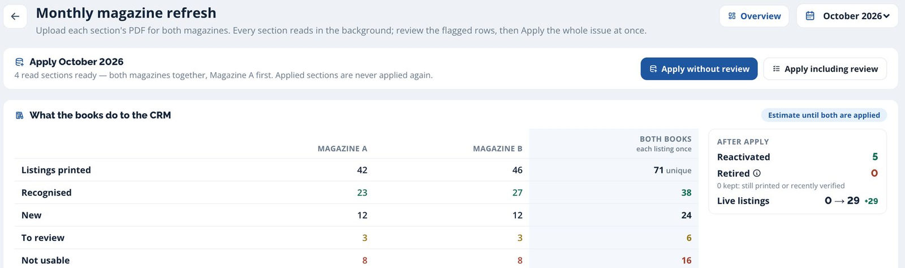

*One issue, both magazines: the PDF sections read so far and what applying them will do to the CRM (demo data).*

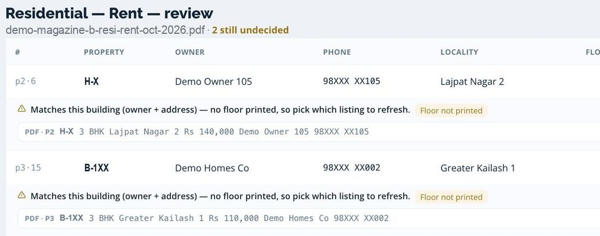

*The review queue: only the lines the reader was unsure of, with the printed source text.*

### People decide only *the unsure lines.*

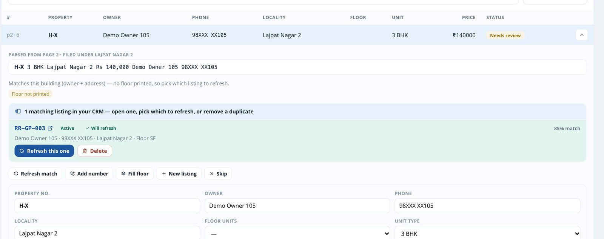

*A review row opened up: the printed line, the matching CRM listing with its % match, one-tap fixes and the editable fields (demo data).*

  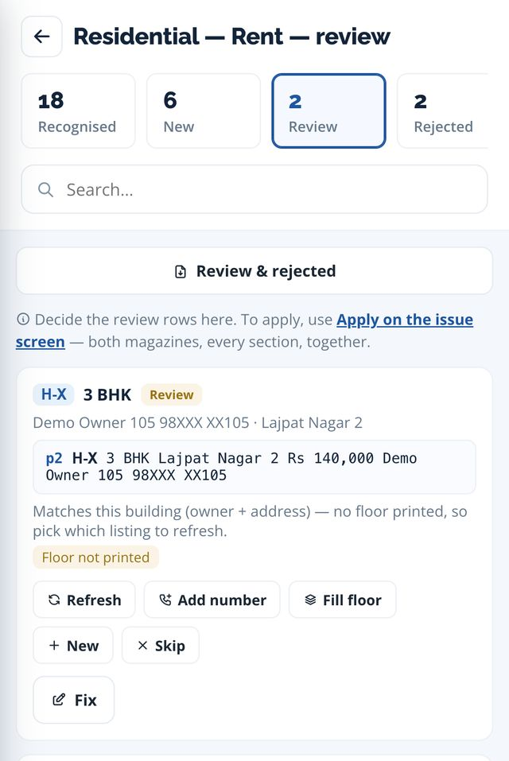 
  <em>The same queue on the phone: Refresh, Add number, Fill floor, New or Skip per line.</em>

| **274** | **355** |
|---|---|
| human decisions across **21,182 printed lines** in two issues (Sept 87, Oct 187) · *database, 23 Oct 2026* | listings reactivated by the two issues (Sept 267, Oct 88) · *database, 23 Oct 2026* |

**What makes it different**
- Rows follow the **printed section**, not each line's wording: that is how the magazines lay out stock.
- Print shorthand is understood: **'850F' is an area** in sq ft, not a floor.
- Plausibility checks flag a **sale price that reads like a rent**, or a lost decimal ('130L' for '1.30L').
- A unit is its **address and floor**, not its printed phone, so a re-advertised floor never duplicates.
- Retirement is **once a month across both magazines**; listings verified in the last 10 days stay live.
- A new locality spelling chosen in review is **saved as an alias** for next time.

### Search it the way *a client says it.*

**1,463** free-text searches by **8 staff**, 6–22 Oct 2026.

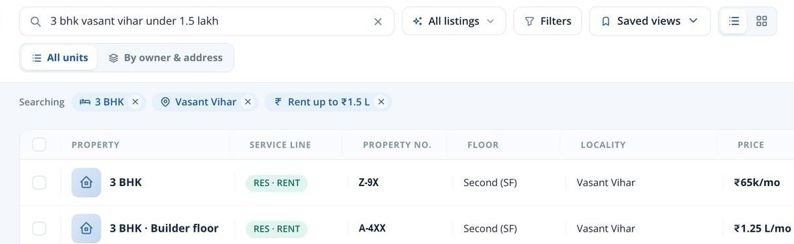

*“3 bhk vasant vihar under 1.5 lakh” becomes filter chips: 3 BHK · Vasant Vihar · rent up to ₹1.5 L.*

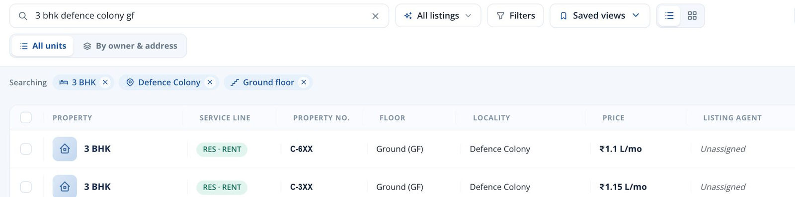

*Desk shorthand: “3 bhk defence colony gf” reads as 3 BHK · Defence Colony · Ground floor.*

  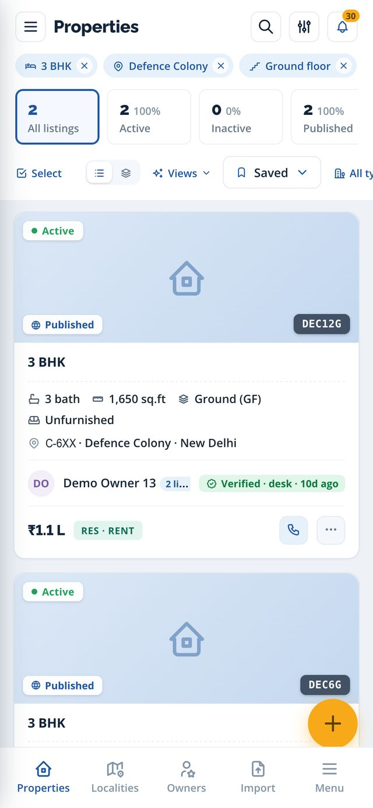 
  <em>Same search on the phone.</em>

**What makes it different**
- It reads desk shorthand: **‘FF’ is first floor**, not ‘fully furnished’.
- Plot sizes in **square yards are converted** before comparing; the old search compared sq yd with sq ft and found almost nothing.
- Colony families and roman numerals (**Lajpat Nagar parts 1–4, GK-II**) match the way stock is named on calls.
- The website, Roofie and staff search **share one parser**; the CRM adds desk shorthand on top.

### Find anything. *Keep the stock clean.*

| **98%** | **119** | **54** | **1,461** |
|---|---|---|---|
| of 12,152 live listings loaded by import (22 Oct 2026) | localities in the master, 84 of them serviced (23 Oct 2026) | duplicate builder spellings merged; 224 firms, 324 phone numbers linked (22 Oct 2026) | data-quality flags raised 4–22 Oct 2026 (177 resolved) |

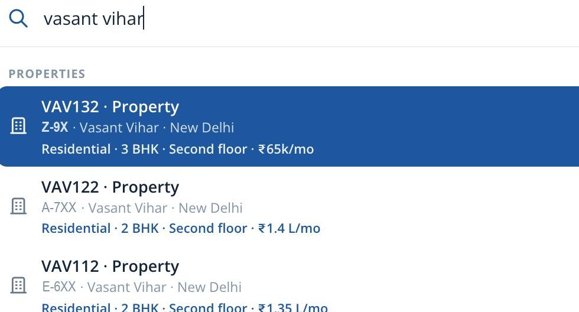

*⌘K from any screen: properties and localities, with keyboard navigation.*

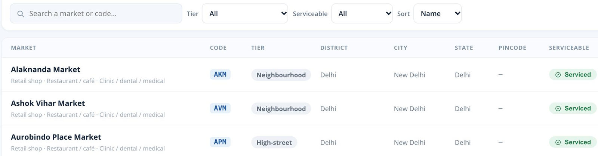

*One master for colonies and commercial markets: code, tier, district and serviced flag on every row (demo data).*

**What makes it different**
- Search never shows a record you couldn't open; enquiries match on **name, phone, email and code** only.
- Codes are **3 characters, unique across both masters**; markets are graded by format: mall, high street, wholesale.
- Each night a sweep checks live listings for **impossible prices, sq ft/sq yd mix-ups and outliers**; it only flags, and a person decides.
- A merge moves deals, tasks, photos and numbers to the kept listing; the same unit **for rent and for sale stays two listings**.

---

## 03 · Listing verification

### “Survey master”: a desk that keeps listings *true.*
Every listing has a freshness clock (rent 30 days, sale 45). Lapsing stock becomes checks (calls, visits, shoots), tracked live.

| **789** | **1,644** |
|---|---|
| of 815 listing checks done since the desk opened (9–11 Oct) to 22 Oct 2026 | listings verified to 22 Oct 2026 (1,099 on 5 Oct) |

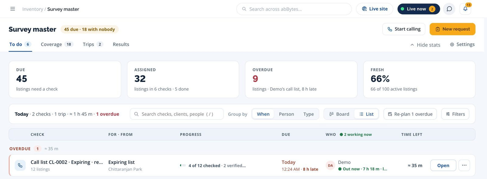

*The “To do” board: due, overdue and fresh counts, then every open check by due date (demo data).*

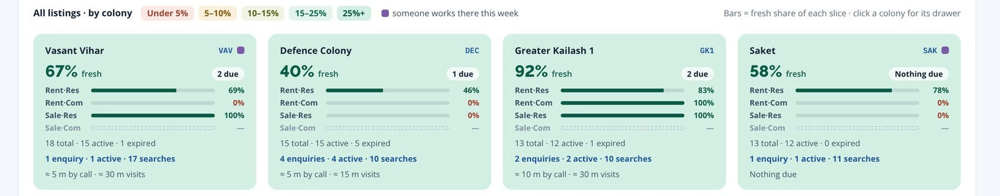

*Coverage: a tile per colony, showing how fresh its listings are and the demand pulling on it (demo data).*

### Call mode: one owner, the facts, *one tap per outcome.*

**199 owner calls in 3 days.** First three days, **21–23 Oct 2026**: 3 callers, 88 owner numbers, 43 calls connected.

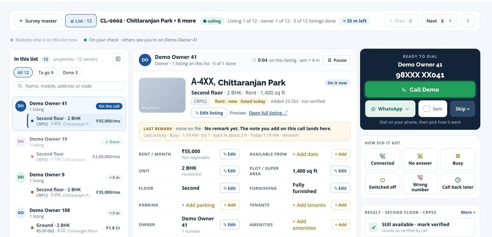

*Call mode: the owner, the listing's facts, the last remark and one-tap outcomes, timed against the per-listing aim (demo data).*

  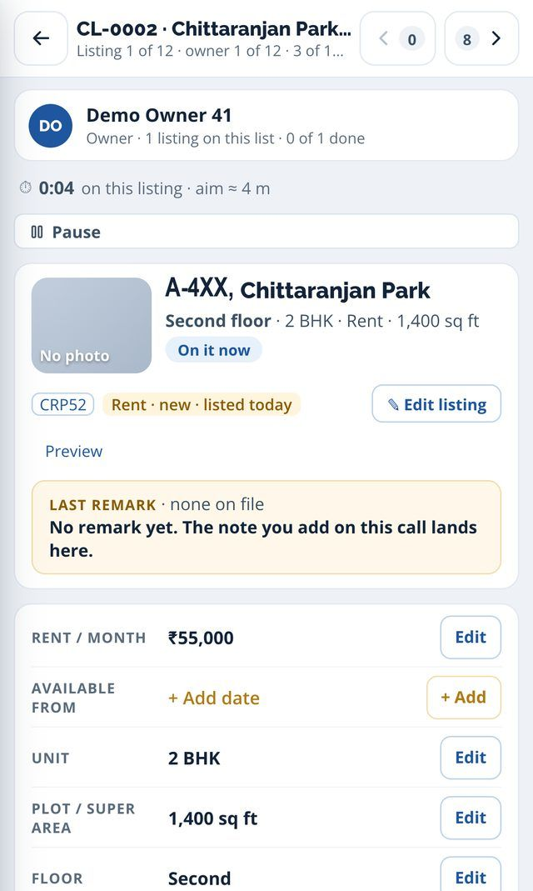 
  <em>Call mode on the phone.</em>

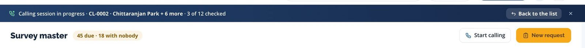

*The calling-session banner follows the caller across the CRM, with “Back to the list”.*

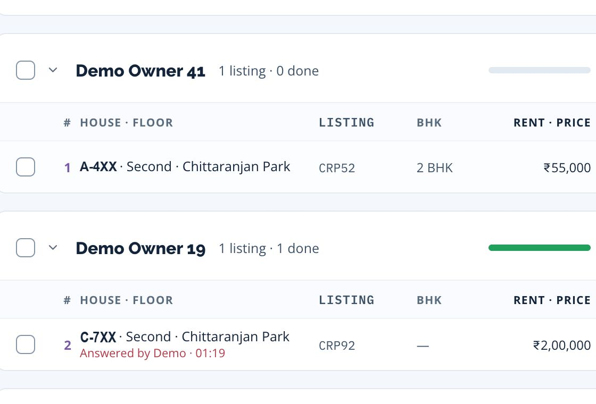

*A call list: 12 listings across 12 owners, grouped by owner (demo data).*

**What makes it different**
- Dialled from the caller's own phone and logged by **one-tap result**, so records don't need telephony.
- A missed call **never unpublishes** a listing: it comes back in about 2 h; 3 misses (a setting) go to a person.
- **One owner, one call:** a landlord's listings stay together, and one miss is logged on all of them.

### The desk runs on *the manager's rules.*

> **Capabilities:** auto-assign · week planner

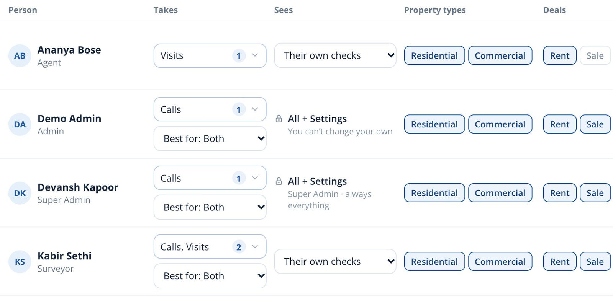

*Settings › Who surveys what: what each person takes, sees and covers (property types, deals, colonies), plus days, hours and daily capacity; minutes per call, visit stop and shoot are set here too, and auto-assign of waiting visits ships off.*

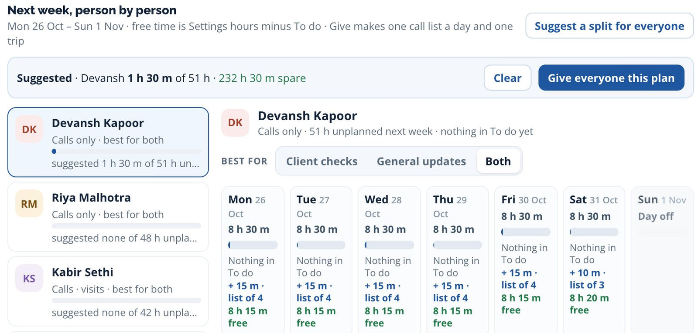

*The week planner (not yet live): “Suggest a split for everyone” proposes each person's share of next week from Settings hours minus To do.*

**What makes it different**
- Checks are **ordinary tasks**: they sit in each checker's Tasks list beside client follow-ups and count in the same totals.
- **One freshness rule** (rent 30 days, sale 45) drives this desk, property matching and the website's Verified badge.
- A Videographer opens **only listings on their open shoots**, and access ends when the shoot is done.
- Estimates use the **one ‘minutes per call’ setting** everywhere, from the call list to next week's plan.

### Field trips, *ready when the desk needs them.*

> **Capability** · built, 0 trips run as of 22 Oct 2026

Plan a trip picks the most-needed stops in a colony; the surveyor runs it from the phone, and results land on the desk stop by stop.

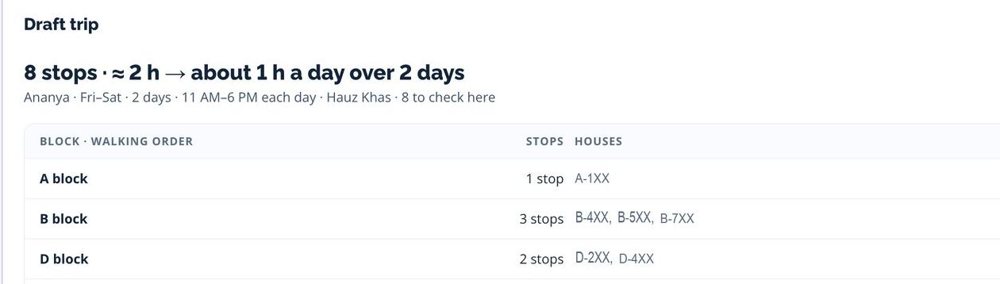

*Plan a trip: the most-needed stops in a colony, spread over two days in block walking order.*

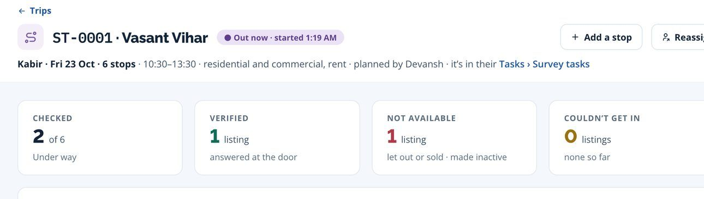

*A trip in progress (demo): results arrive stop by stop, ahead of or behind plan.*

  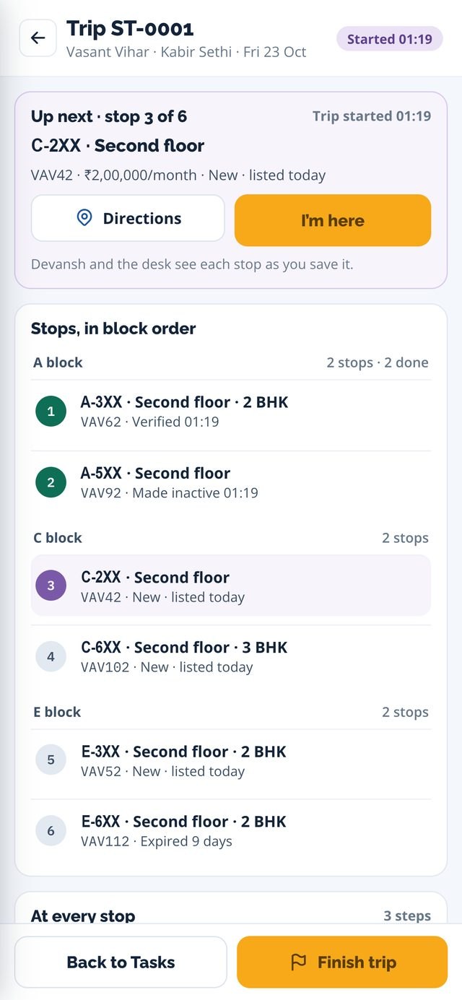 
  <em>The surveyor's phone: next stop, Directions, “I'm here”, stops in block order.</em>

**What makes it different**
- Stops follow **colony, then block, then house number**, which is how South Delhi addresses work.
- A trip is sized from the **per-stop minutes and trip day (with lunch) set in Settings**; if it runs long it offers more days or fewer stops.
- A To-Let board seen on a trip is matched by **phone, colony, house no. and floor**, or becomes a new listing.

---

## 04 · People & calling

### Every follow-up in one list, *overdue first.*

| **2,397** | **1,551** |
|---|---|
| tasks completed in the 30 days to 22 Oct 2026 (1,608 client work + 789 listing checks), against **1,014** in the 30 days to 5 Oct, before listing checks began | follow-up call tasks completed in the 30 days to 23 Oct 2026 |

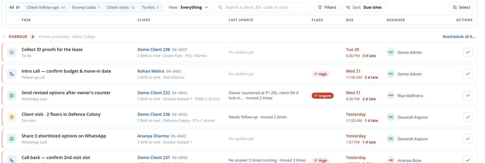

*The Tasks list: one row per task with the client and brief, the last call outcome (“No answer 3 times running · moved 3 times”), how late it is, and “Reschedule all” on the overdue group (demo data).*

  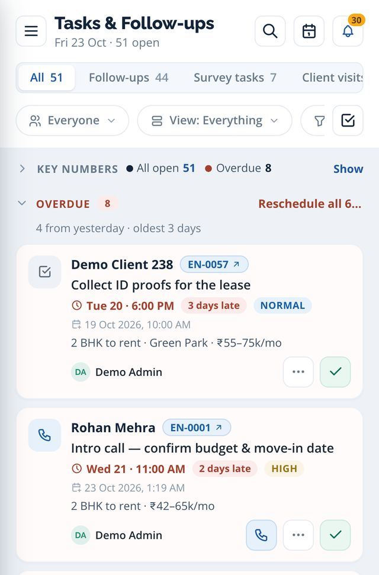 
  <em>The phone: overdue first, call or complete in one tap.</em>

### Whose tasks, *which tasks.*

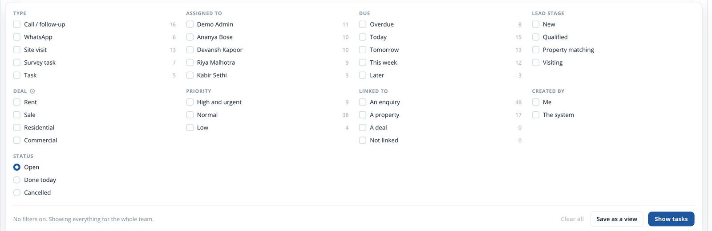

*Inline filters: type, owner, due window, lead stage, deal, priority and what the task is linked to, each with a live count; any mix saves as a named view.*

| 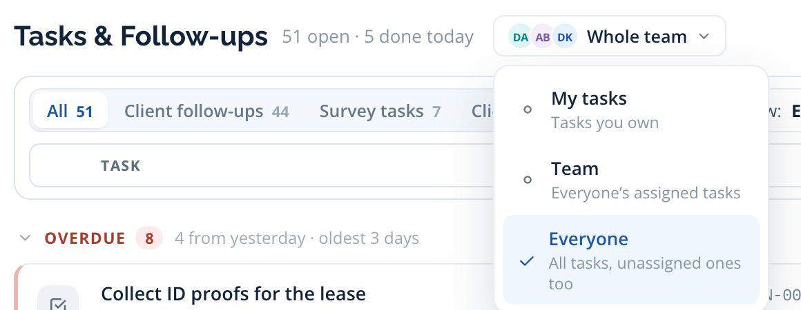 | 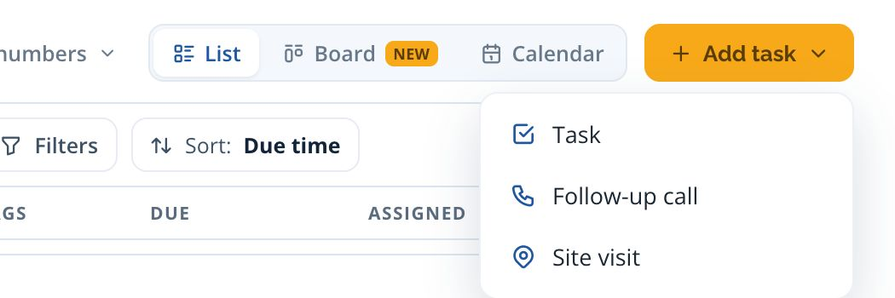 |
|---|---|
| “Whose tasks”: My tasks, Team, or Everyone including unassigned. | Add task: a plain task, a follow-up call or a site visit. |

**What makes it different**
- Every move reads dates as **IST and refuses past days**.
- Roofie follow-ups fall due **2 office hours later**, not overnight.
- Type tabs (All · Client follow-ups · Survey tasks · Client visits · To-dos) **share one queue**.
- Listing-check tasks **never move a lead's next follow-up**, so desk work stays separate.

### Plan the week. *Move many at once.*

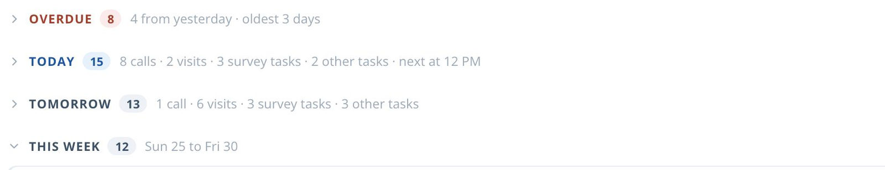

*Groups fold to one line (“4 from yesterday · oldest 3 days”); This week opens day by day.*

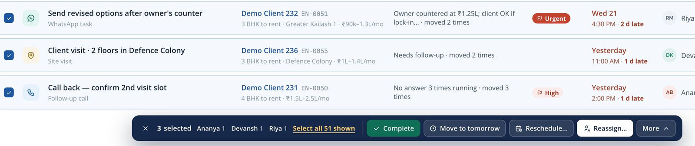

*Select mode: tick rows and the bar shows whose they are, with Complete, Move to tomorrow, Reschedule… and Reassign….*

  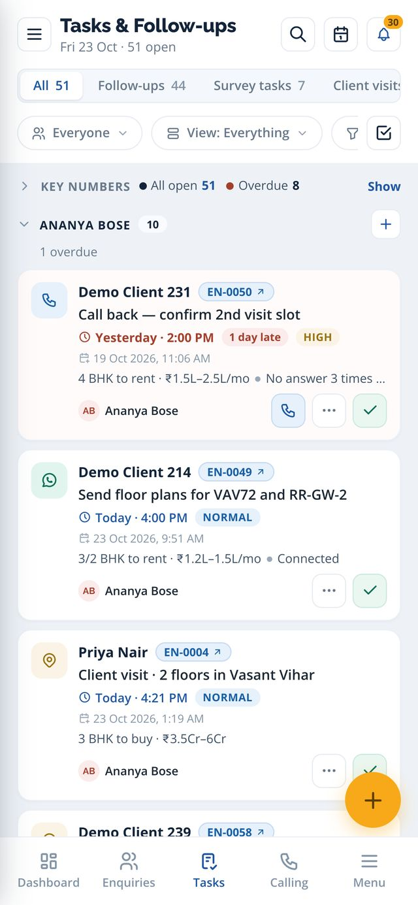 
  <em>The phone board, grouped by person, with “+” to add for that person.</em>

**What makes it different**
- Moves, reassigns and deletes offer **Undo**.
- Bulk follow-up creates **one task per client** and updates each lead's own next-follow-up date.
- For a departing agent, bulk hand-over shows **whose leads you are moving** and sends each person one summary alert.

### Board and calendar: *drag to reschedule.*

| 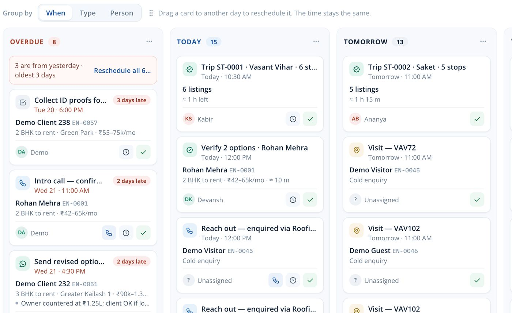 | 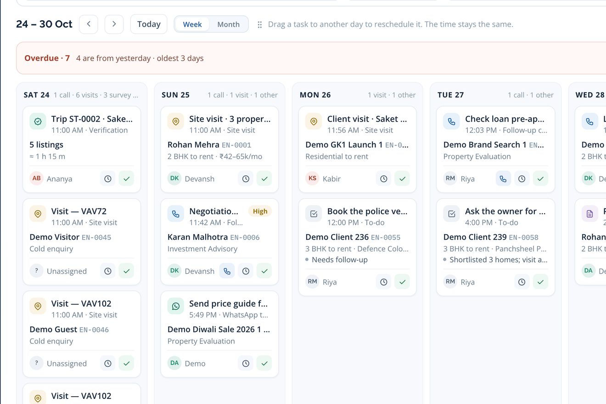 |
|---|---|
| Board: drag a card to another column to reschedule it; the time stays the same. | Calendar: an overdue strip with “Reschedule all”, then calls, visits and survey tasks per day. |

  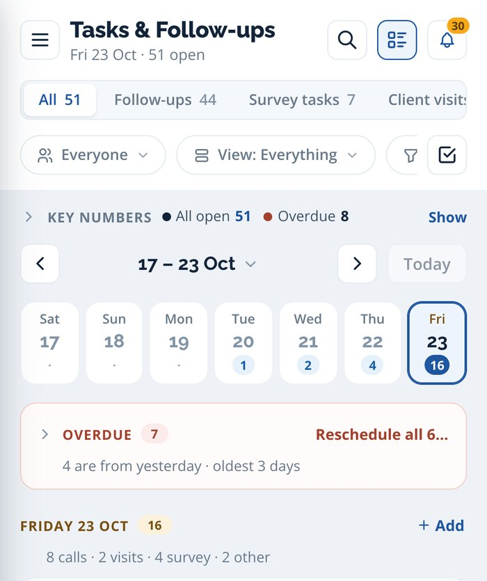 
  <em>The phone: a week strip with counts per day.</em>

**What makes it different**
- The overdue planner books about **10 calls an hour in 6-minute slots**, around 90-minute visits, and never after 7 PM.
- **Visits never move** when the planner reshuffles, so a client's booked site visit stays where it was agreed.

### Calling queues *that build themselves.*

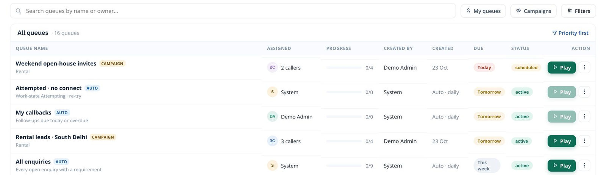

*Calling queues: automatic queues worked out fresh each time, plus campaign queues built from lead filters; each row shows who is assigned, progress and a Play button (demo data).*

  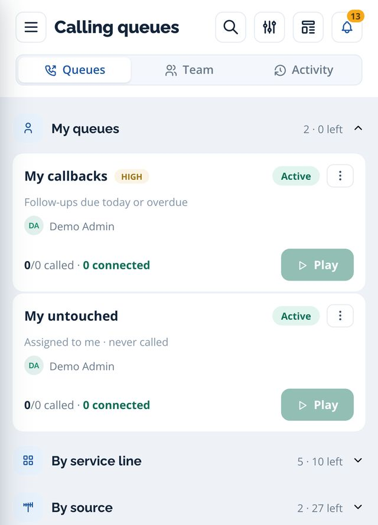 
  <em>Queues on the phone.</em>

**What makes it different**
- Audiences are **live filters**, so leads that no longer match drop out of the queue.
- **‘Skip if already called’** leaves out any number a teammate dialled today.
- A **soft lock** shows who has a contact open and lapses after 10 idle minutes.

**Telephony**
- I set up the **cloud telephony (IVR)** account with the vendor; click-to-call and DLT SMS are connected to the CRM.
- Dialling stays **off per person** until an admin turns it on, because each number registered with the provider is billed.

---

## Calling sessions

*04 · People & calling, continued.* Press Play on an enquiry queue, or start an owner call list, and the CRM keeps the caller's place: the next lead or owner, its history and its number are already on screen, the call is logged beside it, and a banner brings the caller back to the same call after a full edit. These are descriptions of how the screens work; no time saving has been measured, so none is claimed.

| **1,551** | **199** |
|---|---|
| follow-up call tasks completed in the 30 days to 23 Oct 2026 (all follow-up calls, not only those made from queues) | owner calls in call mode's first 3 days (21–23 Oct 2026), by 3 callers, reaching 88 owner numbers; 43 connected |

### Call, log, edit, *back on the same call.*
For enquiry follow-ups: the next lead, its history and its number are **already on screen**.

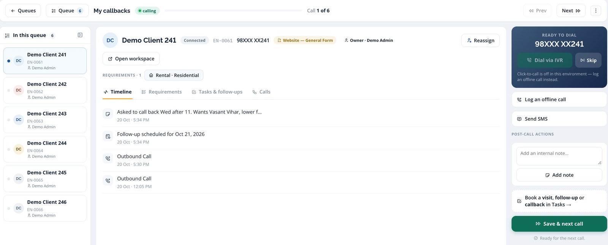

*Play starts the queue: call 1 of 6 with the lead's history. Dial via IVR (off in this demo copy) or log an offline call, Send SMS, book a follow-up in Tasks, then Save & next call.*

| 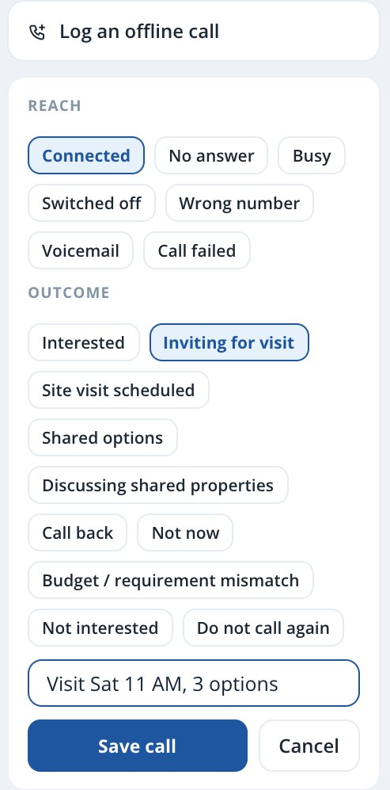 | 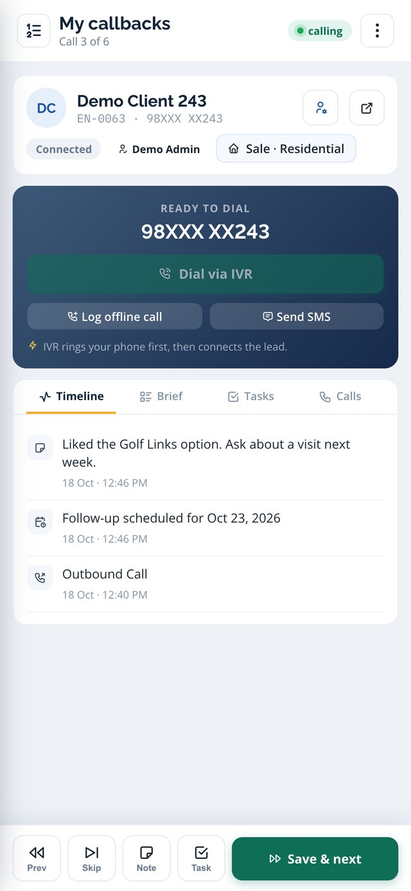 |
|:---:|:---:|
| Log a call: one tap for the reach, one for the outcome, a note, Save call. It carries the queue's name (demo data). | The phone (a session started at contact 2): after Back, Save & next opens call 3 of 6 (demo data). |

*Open workspace edits the whole enquiry. On that record only, this strip stays on top (its empty middle cut here); Back to the queue returns to the same call.*

#### Step by step: an enquiry queue

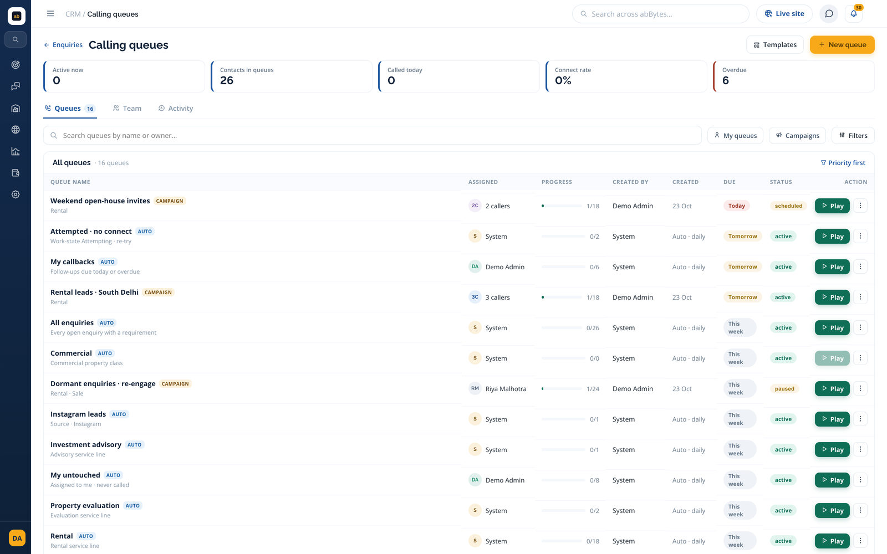

*1 · The Calling queues board: 12 automatic queues worked out live plus saved campaign queues, each with its callers, progress, a Due label that shows priority (not a date) and its own Play button (demo data).*

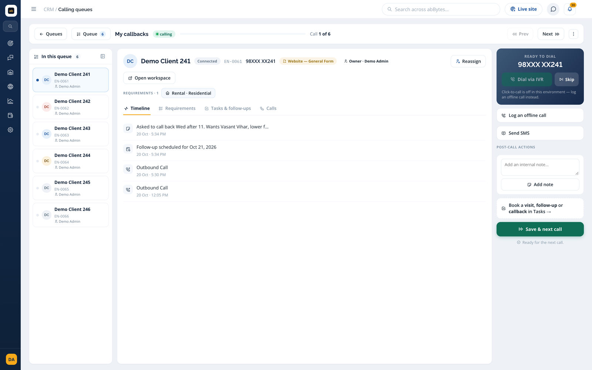

*2 · Play on “My callbacks”: call 1 of 6, the six leads in play order, the lead's last remark and earlier calls on its Timeline, and the dial card (demo data).*

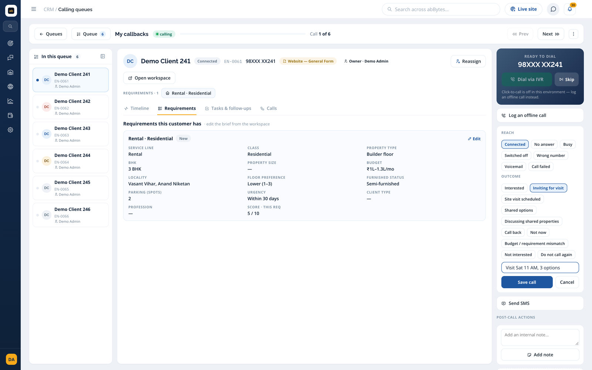

*3 · The call, logged from this screen: the brief on the Requirements tab, then “Log an offline call” with one tap for the reach, one for the outcome and a one-line note (demo data).*

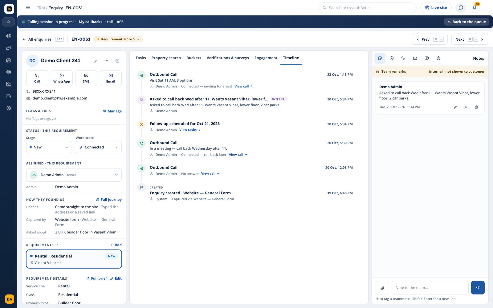

*4 · Open workspace: the full enquiry record, every field editable, under “Calling session in progress · My callbacks · call 1 of 6 · Back to the queue”; the call just logged is already on its Timeline (demo data).*

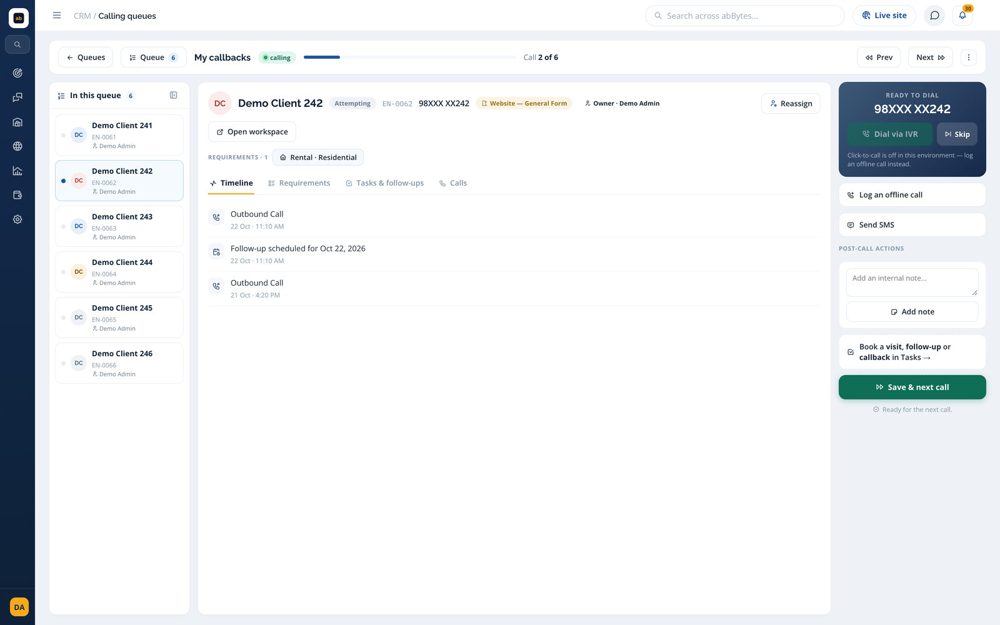

*5 · Back to the queue, then Save & next call: call 2 of 6, the next lead with its own earlier calls (demo data).*

| Preview | Log a call | Record + banner | Next call |
|:---:|:---:|:---:|:---:|
| 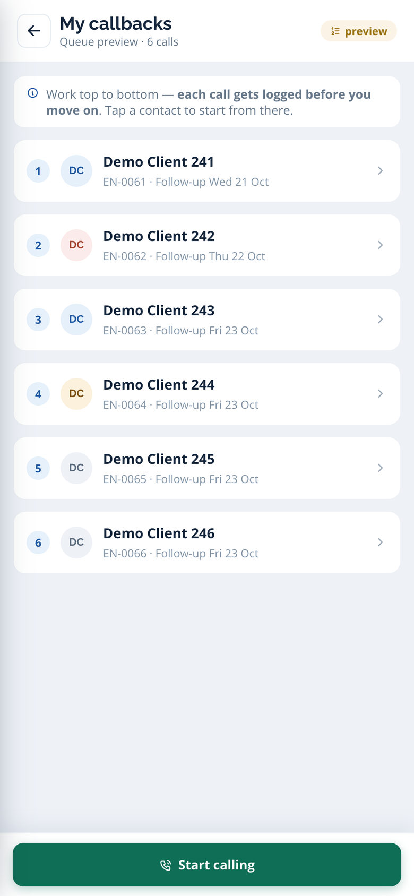 | 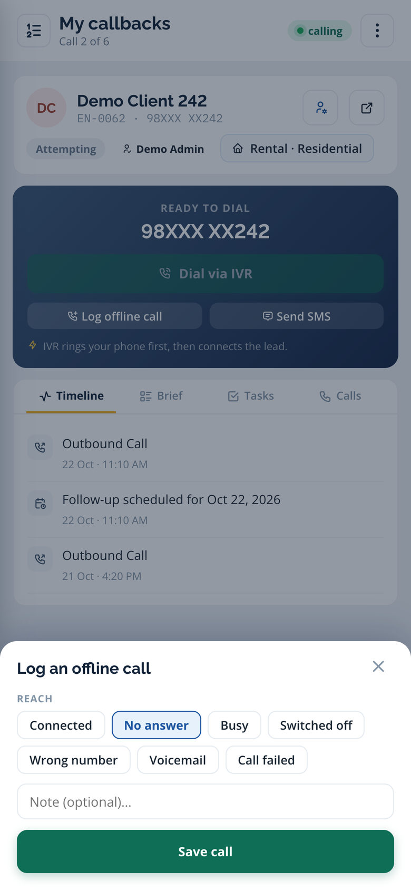 | 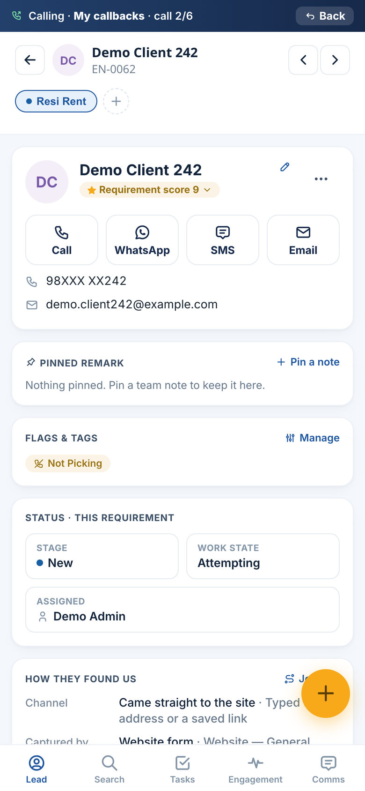 | 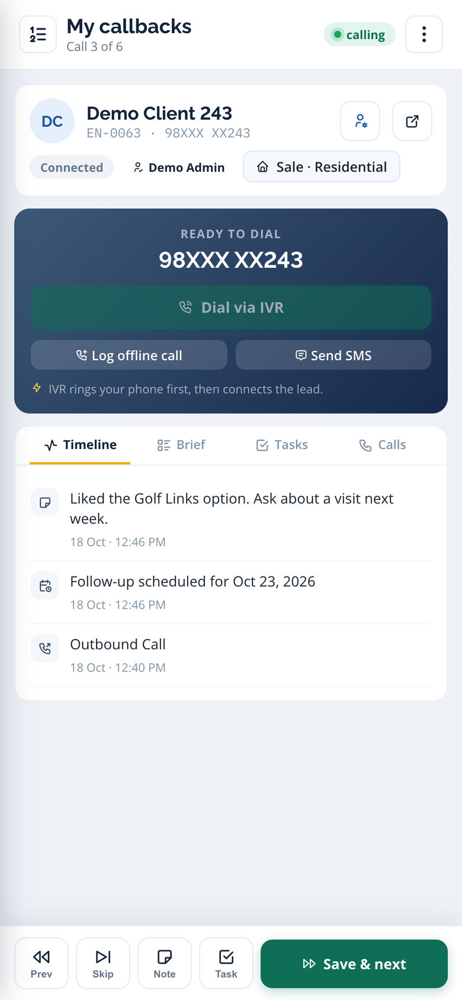 |
| The play order 1–6 with follow-up dates; tap a contact to start there. | A missed call logged in two taps. | The third miss in a row raised “Not Picking” by itself; Back returns to the call. | Call 3 of 6, with Prev · Skip · Note · Task · Save & next. |

### Call the owner, *edit the listing mid-call.*
For listing checks: the owner's answers go **straight into the listing** during the call.

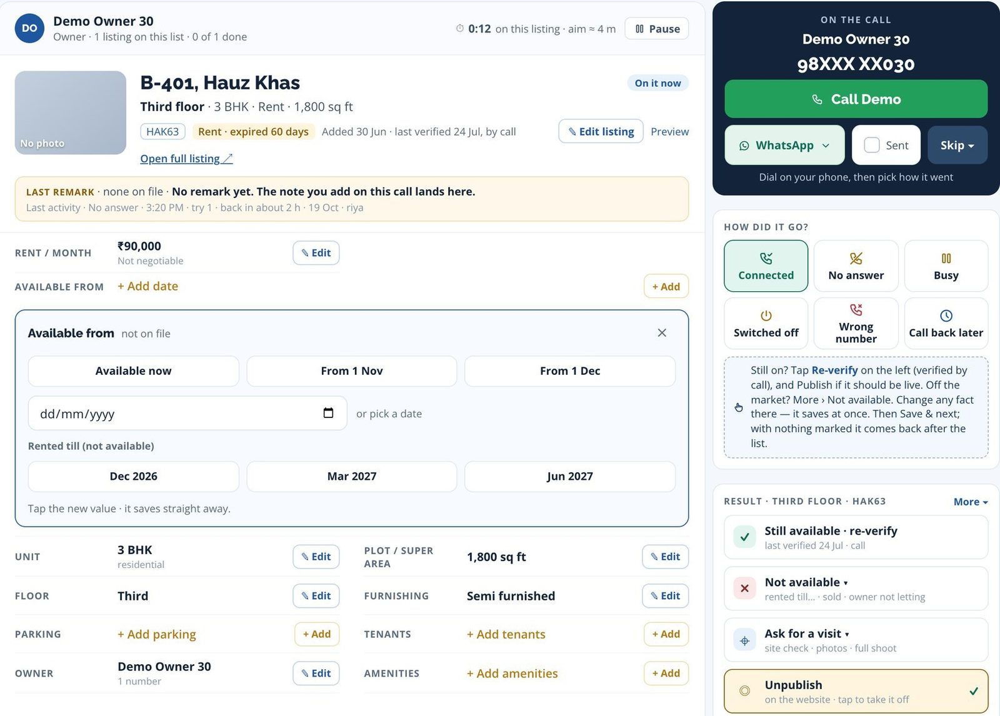

*Call mode: the listing's facts are edited in place (here “Available from”, saved on tap), then one tap for how it went, Call back later, or a result.*

  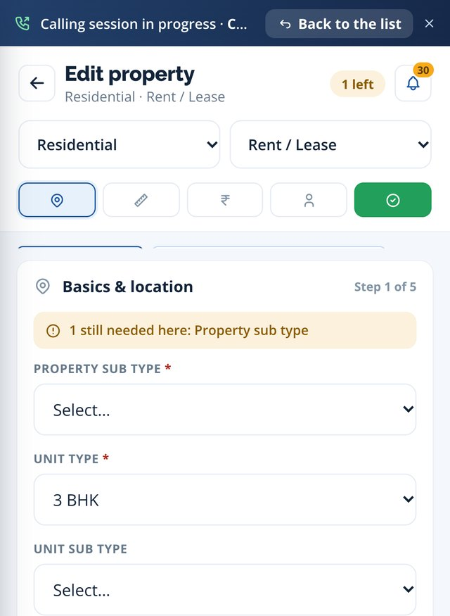 
  <em>✎ Edit listing opens the full editor. The banner's “Back to the list” returns to the same owner; ✕ hides the banner and the list keeps running (demo data).</em>

*Back on the list at the same listing, still 10 of 12: Still available marks it verified by call, and the list moves to 4 of 12 done.*

**What makes it different**
- **Two banners, two rules:** this one follows the caller everywhere; the enquiry banner stays on the enquiry record only.
- **Save & next owner** skips listings already done.

#### Step by step: an owner call list

*1 · Call mode for a call list: listing 10 of 12, the owner with a timer against the aim, the listing's facts edited in place (here “Available from”), and “How did it go?” with the Result rows (demo data).*

*2 · ✎ Edit listing: the full listing editor under “Calling session in progress · CL-0002 · 3 of 12 checked · Back to the list · ✕” (demo data).*

*3 · Back through the banner: Connected, then “Still available · mark verified”; the listing reads Verified and the list moves to 4 of 12 done (demo data).*

*4 · Save & next owner: listing 12 of 12, because listing 11 was already done and is skipped (demo data).*

| Call mode | Call sheet | Edit + banner | List sheet |
|:---:|:---:|:---:|:---:|
|  |  |  |  |
| Owner, timer, listing card and facts, with the fixed Call · WhatsApp · Sent · Skip bar. | “How did it go?”, the Result rows, a note and Save & next owner on one sheet. | The listing editor opened from the call, with Back to the list and ✕. | One owner ticked Done, the next “On the call”: Done 5 of 12. |

*About these shots:* demo data on a demo copy. Click-to-call (IVR) is switched off in the demo, so “Dial via IVR” is greyed out and calls were logged with “Log an offline call”; owners are called from the caller's own phone. Phone numbers are masked in these screenshots for publication, not by the app. No call audio, recordings, live IVR or caller pop-ups are shown or claimed.

---

## Deploying calling work without spreadsheets

*04 · People & calling · Deploying work.* On one page, as in the PDF:

| 01 · Live audience | 02 · Fixed list | 03 · Callers | 04 · Priority | 05 · Listing checks |
|---|---|---|---|---|
| Class, rent/sale, area, source, lead score, stage, last contact. | Any Enquiries filter, then “Select all N” → new queue. | None (shared pool), one, or several on one list. | Due label: Urgent today, High tomorrow, None this week. Sets board order. | Who calls or visits, by colony, day, hours, capacity. |

**What makes it different**
- **Outcomes write back:** new-lead work-state, owner if unowned, “Not Picking” after 3 misses.
- Open a lead mid-queue; **a banner returns you** to “call X of Y”.

**Status · production, to 23 Oct 2026:** 4 queues run (2 completed) · 1,551 follow-up call tasks done in 30 days (not all from queues) · 199 owner calls in 3 days, 21–23 Oct 2026.

Before calling queues, the brokerage's lead lists were exported to Excel, split per caller or team, edited and sent round again. Calling queues replace that export-to-Excel routine: an admin sets the audience and who works it inside the CRM, callers work the list on the calling screen, and each call's outcome goes straight back onto the lead. No time saving has been measured, so none is claimed here.

### Choose the audience
- **Queue builder (admins): a live list.** Six steps (Name · Audience · Filters · Pipeline stage · Run settings · Assign callers) with a live "N enquiries match right now" preview. Filters: class (Residential / Commercial / Advisory / Evaluation), service line (Rental / Sale), localities, source (website form, Instagram, Meta ads, walk-in, IVR inbound, WhatsApp, channel-partner or broker referral), minimum lead score (4+ / 6+ / 8+), days since last contact (3 / 7 / 30+), lifecycle stage and work-state. The queue stores the rules, not the names, so it recalculates from live data every time it opens. Closed and junk leads are left out.
- **From the Enquiries list: a fixed list.** Use any of the list's filters (seven groups: stage & status, what they want, where, budget, who, activity & dates, data quality), a smart view or a search, then tick rows or "Select all N" → **New calling queue**. This creates a new, active, fixed list straight away.
- **10 one-click templates** pre-fill the builder, among them: Untouched leads · Attempted, no connect · Cold re-engage (30 days) · Hot & high-intent (score 8+) · New from Instagram · New from Website · Advisory, high value (6+) · Negotiating, stuck 7 days · All-enquiries blitz.
- **12 automatic queues** (My callbacks, My untouched, Rental, Sale, Instagram leads, Website enquiries, Attempted · no connect and more) are worked out fresh each time; "Save as a campaign…" copies one into an editable, assignable queue.

### Choose who works it (coverage)
- **Callers:** a searchable list, filtered by Internal / Channel partner / Affiliate. Pick nobody and the queue is a shared pool any caller can play; pick one and it is theirs; pick several and they work the same list. Reassign at any time.
- **Soft lock:** the contact on screen is marked as the caller's, others on the list see who has it, and the mark lapses after 10 idle minutes. It warns; it does not block a second dial.
- **Priority:** None / High / Urgent sets the board order and a Due label (This week / Tomorrow / Today); the label is not a deadline.
- **Duplicate rule (set by the system):** builder queues skip numbers anyone has dialled today, so those leads come back the next day; hand-picked lists keep every number.
- **Lifecycle:** new builder queues start Paused and go live when an admin sets them Active. A queue that has been played can only be Ended, so its call history is kept. Duplicate and Edit from the row menu.
- **Visibility:** callers see only Active queues assigned to them or pooled. Numbers are masked unless the user may see them; the real number is still dialled.

### Work the queue
- **Play** takes the next 100 contacts in order: saved queues newest enquiry first, automatic queues by follow-up date.
- **The console** shows the lead's timeline, requirement brief, tasks and follow-ups, and call history, with Dial via IVR (for users switched on) or a logged offline call, Skip, and Send SMS from a DLT template.
- **Outcome in two steps:** "Did you connect?" (Connected / No answer / Busy / Switched off / Wrong number / Voicemail / Call failed), then, if connected, what happened (Interested, Site visit scheduled, Call back, Not interested, Do not call again and more), a note and an optional follow-up task for tomorrow. "Save & next call" stays locked until the outcome is saved.
- **What a logged call changes by itself:** a new lead moves to Attempting or Connected; an unowned lead with a requirement goes to the first person who calls it (an owned lead never changes hands); 3 unanswered calls in a row flag "Not Picking", 7 flag "Ghosted", and a connected call clears both.
- **Session banner:** open a lead mid-queue and a bar reads "Calling session in progress · *queue* · call X of Y · Back to the queue".

### Track it (admins)
- KPI strip: Active now · Contacts in queues · Called today and Connect rate (the viewer's own calls) · Overdue (the viewer's callbacks due).
- Queue table: progress (called / total), the Due label, a status pill that pauses or resumes on click, and filters by type, service line, source, stage, assignee, status and priority.
- Team tab: who is in a session right now, and today's calls, connected and connect % per caller. Activity tab: the latest 80 calls with outcome and note.

### Listing checks: the "Survey master" desk
The same idea, for keeping listings current.
- **Who surveys what (per person):** takes Calls / Visits / Shoots / Not applicable; best for client checks, general updates or both; residential / commercial; rent / sale; colonies; working days; hours; capacity a day (N calls or N stops); start point. "Sees" (own checks / all of Survey master / all + Settings) is written as real permissions.
- **Coverage tab:** for each colony and slice (rent / sale × residential / commercial), live stock and how much is fresh (checked within 30 days for rent, 45 for sale), ranked by demand: open enquiries plus website searches.
- **Get it checked:** Call / Visit / Shoot; one person or several, Together (one shared task, divided during calling) or Split (one task each, cut in colony → block → house-number order, never splitting one owner's listings across two callers); When: end of their queue, first in their queue, now, or a set time. A call list is spread over the checker's real days and hours.
- **Auto-assign that explains itself:** e.g. "Auto · *name* · most free time today · covers GK 1", and a plain "Nobody is set to take visits yet · pick a person" when nobody fits.
- **Time estimates:** 4 minutes a call, 15 a visit stop, 45 a shoot (editable); one owner with three listings counts as one call.
- **End-of-day roll:** unfinished flexible call checks move to the person's next unplanned time instead of piling up as overdue.

### Numbers (to 23 Oct 2026)
- 4 calling queues run (2 completed, 2 active).
- 1,551 follow-up call tasks completed in the 30 days to 23 Oct 2026 (all follow-up calls, not only those made from queues).
- Owner calling: 199 owner calls in its first 3 days (21–23 Oct) by 3 callers, reaching 88 owner numbers; 43 connected.
- Listing checks: 789 of 815 check tasks done since the desk opened (to 22 Oct); 1,644 listings verified in all (1,099 on 5 Oct).

### Limits and what is not built yet
- A caller works the part of a queue's audience that their own access allows: people with the "view all enquiries" permission see all of it, other callers only the leads assigned to them.
- Several callers on one list all play the same list; the soft lock only shows who has a contact open, and the list is not divided round-robin. The daily quota per caller (default 75) is saved with the queue but not enforced.
- The builder's locality chips list the first 24 localities A–Z; for any other area, filter on Enquiries and make a fixed list.
- No timed retry engine for enquiry queues: retries come from the live audience, the "Attempted · no connect" queue, callback tasks and the no-response filters.
- Not built: scheduled start, branch scoping, pushing a queue to the telephony auto-dialler.
- Field trips and visit auto-assign are built but not used yet (0 trips). Automatic routing of new enquiries is switched off; Survey master's auto-assign is a separate, on-demand pick.

---

## Telephony and messaging built in

*04 · People & calling · Telephony & SMS.* On one page, as in the PDF:

> **Capabilities:** inbound IVR · SMS campaigns · automations

| 01 · Click-to-call | 02 · Inbound IVR | 03 · SMS templates | 04 · Campaigns | 05 · Fee reminders |
|---|---|---|---|---|
| Rings the agent first; the client sees the business number. An admin turns it on per person. | Capability: rings the lead's agent; unknown callers become leads. | DLT ID, sender, type; each blank fills from the lead or due, or is asked when sending. | Capability: Enquiries filters or saved audiences, schedule, pace, opt-outs, 7-day cap. | Before, on and after the due date; an admin sets the days, cap and send hour (automatic: capability). |

**What makes it different**
- Only **DLT-registered templates** send; bulk and automatic texts never go 7 PM – 9 AM IST.
- **“Remind now”** works with automations off; reminders stop once paid.

**To 23 Oct 2026:** 0 SMS campaigns sent · automations all OFF · 4 fee reminders sent by hand · 13 calls logged via telephony.

Calling and texting run from inside the CRM through the providers' APIs: Knowlarity for cloud telephony / IVR and Airtel IQ for DLT SMS.

### Cloud telephony (Knowlarity IVR)
- **Click-to-call** from an enquiry, a deal (tenant / landlord or buyer / seller), a property owner, a website-user profile or a calling-queue session. The CRM asks Knowlarity to ring the agent's own phone first, then connects the client from the business number, so the client sees the company's caller ID.
- Every dial is written to the timeline straight away. The outcome form opens by itself when the provider's call summary arrives (or after 30 seconds if none does), and a call that never connected is logged as No answer without the form. A failed dial shows the provider's actual reason, and an 8-second guard stops a double tap from placing two calls.
- **Inbound routing (capability):** for each incoming call, the IVR can ask the CRM which agent to ring. The CRM answers with the lead's assigned agent (or, for a lead with no requirement yet, its intake owner). An unknown caller, an unassigned lead or an error returns no agent, which sends the call to the IVR menu instead.
- **Inbound logging and capture (capability):** calls are logged on the caller's existing enquiry, and an unknown number can become a new lead tagged "IVR Inbound" (switchable). Staff numbers never become leads. A missed call sets a same-day follow-up date if none is set; the lead's agent gets a who-is-calling pop-up and admins get an alert.
- **Per-person IVR switch** in Team & Access, off by default because every number registered with the provider is billed. Without it, the agent rings from their own phone and logs the call in the same outcome form.
- **Not built:** pushing a calling queue to the provider's automatic outbound dialler.

### DLT SMS: templates
- Only templates with a DLT template ID can be sent; free text never is. Login-code templates can never go out as customer messages.
- **Template manager (admins):** DLT template ID, internal code, sender header, type (service implicit, service explicit, transactional, promotional) and the exact approved text. Each blank is a tag the admin points at a fill: first name, what they want, area, their agent, next site visit, next follow-up, enquiry code; for payments, who pays, what is due, amount, due date and days until or past due; fixed words; or "ask when sending". Each fill has fallback words.
- Preview on real enquiries, and send a test to your own phone. Blanks are capped at 30 characters; numeric blanks keep digits only.

### DLT SMS: campaigns (capability)
- **Three steps:** Who gets it · What it says · Review & send. A goal (Re-engage / Share listings / Qualify / Promotion / Something else) suggests a starting smart view.
- **Audience:** the Enquiries filters (seven groups), a smart view (going cold, ghosted, qualified at least once and more), people ticked on Enquiries ("Create campaign" from the bulk bar), or pasted numbers (texted only if already in the CRM). Live list (re-checked at send) or frozen at launch. **Saved audiences** keep the filters and re-match whoever fits today.
- **Who is left out, one reason each:** junk, no valid Indian mobile, opted out, same number as someone earlier on the list, unticked, texted in the last N days (default 7), got an earlier campaign, site visit coming up. Opt-outs and the N-day check run again for each text at send time.
- **Sending:** now or at an IST date and time; pace presets (default 50 texts every 2 minutes) with a finish estimate; pause, resume, cancel, duplicate; optionally notify lead owners when it finishes.
- **Report:** credits used, and per person: sent or left out (with the reason) and the provider's reference; CSV export, with numbers masked for anyone not allowed to see them. "Sent" means the provider accepted the text: the CRM receives no delivery reports, and replies do not reach the CRM.

### Service updates and service-fee (brokerage) dues
- **One-to-one service texts** from the enquiry, the deal, the calling console, the owner screen and the website-user profile, using registered templates: welcome, visit scheduled / reminder / cancelled, thank-you after a visit, agreement drafted / signed, property evaluation complete, property-management welcome, payment due.
- **Brokerage dues** per payer (tenant, landlord, buyer, seller), pre-filled (one month's rent for a rental, brokerage % of the price for a sale) and editable; part-payments with date, mode and UTR; write-offs; every change logged on the deal. A Receivables screen shows outstanding, overdue and collected.
- **Reminder schedule:** N days before the due date (default 3), on the day, then every N days while overdue (default 7, at most 3 times), at a set hour (default 10 AM IST). Reminders stop when the due is paid, written off or the deal is lost. **Remind now** on a due works even with the automation off (at most once every 6 hours).

### SMS automations (capability, all OFF)
Five ready-made recipes on one engine: site-visit confirmation and reminder, welcome a new enquiry, re-engage leads going cold, thank-you after a visit, and payment reminders. Each stays off until an admin switches it on. A waiting text can stop if an agent personally reaches the lead first (set per automation; off by default for visit texts, always off for payment reminders). Quiet hours (7 PM – 9 AM IST) and opt-outs apply to campaigns, bulk texts, automations and payment reminders; a one-to-one text goes when the agent sends it.

### Status (to 23 Oct 2026)
- Click-to-call and DLT SMS are connected to the CRM. Telephony logging is lightly used (13 calls), so no recordings, call durations or pop-up results are claimed.
- SMS campaigns: 0 sent; saved audiences unused; all automations OFF.
- Brokerage dues in use: first 2 deals won in the CRM (Oct 2026), 2 dues paid, 3 payments recorded; payment-reminder SMS sent 4 times, by hand.

---

## 05 · Clients & matching

### One lead, one screen: *who they are, the work, every conversation.*

**1,608** client-work tasks (calls, visits, follow-ups) completed in the 30 days to 22 Oct 2026.

Six tabs on every lead: **Tasks, Property search, Buckets, Verifications & surveys, Engagement** and **Timeline**.

*The enquiry workspace (demo client): contact card and pinned remark, flags and tags, stage and work-state, and the Engagement tab with what the client did on the website.*

### Every number *opens its list.*

*The dashboard: Today's brief and Act now; every count opens the list behind it (demo data).*

*Enquiries: stage and work-state, requirement, interest areas and owner on every row; any filter mix saves as a private or team view.*

   
  <em>The list on the phone.</em>

**What makes it different**
- Card counts run through **the list's own filter**, so a tile's number matches the rows it opens.
- Every channel uses **one phone-number check**: a repeat caller lands on their existing enquiry, and saved details are never overwritten.
- A lead with no requirement yet (a **cold enquiry**) is a first-class record, and ‘Cold’ is the intake team's queue.
- Spam rules **lean toward keeping leads**, and every rejection is logged with a masked phone.

### What the client did on the website, *on their record.*

|  |  |
|---|---|
| Recently viewed and searched: each listing the client opened, with view counts and how fresh its check is, plus their searches (demo data). | The website-user record: OTP-verified, “In pipeline”, with saved, viewed, searches and chats. |

   
  <em>Engagement on the phone.</em>

**What makes it different**
- The phone number the agent already has is **the join key**, so browsing lands on the right lead without a separate tool.
- Viewing or saving **never creates a lead**; behaviour attaches only once the person is already a client.
- The engagement score is **a hint that fades over time** and gives its reason; an alert for an active browsing session is a capability.

### Matching: from brief *to a checked shortlist.*

**2,248** property-to-lead matches in the 30 days to 22 Oct 2026 (**1,887** on 5 Oct).

|  |  |
|---|---|
| Property search opens filtered from the brief and ranks 11 matches by % fit, with how fresh each listing's check is (demo data). | Buckets: a custom “Over budget · ask owner”, the automatic Enquired bucket and Shared, with how far each listing sits from the budget. |

   
  <em>Verifications on the phone: available, not available, in progress, not asked yet.</em>

**What makes it different**
- Budget is **a band**, the way brokers negotiate: within ±10% is a fit, ±20% still counts as close.
- A landlord's tenant preference **lowers the score** but never hides the listing.
- **‘Enquired’ never counts as shown**, so ‘Not yet shown’ stays honest.
- The client's handpicked link **needs no login** and shows only public listings.
- A listing already being checked for another client is **linked, not re-checked**.

### Every action *lands on the record.*

**70%** of the 14,297 timeline entries in the 30 days to 22 Oct 2026 were written by the system, not typed (64% on 5 Oct).

|  |  |
|---|---|
| The timeline writes itself: tasks created and the team's internal notes, each with its author and time (demo data). | Team remarks are internal; typing @ opens the teammate picker and the person tagged is alerted. |

   
  <em>This client's tasks on the phone: Today, Upcoming, Done.</em>

**What makes it different**
- Agents spend their time **calling, not writing logs**, yet a manager still sees a complete history.
- Each action **counts once**: a typed call note is a call, not also a note.
- Outgoing texts and edit lines **never count as contact**, so a mass SMS can't make leads look worked.
- The phone **reuses the desktop forms**, so a brief taken on site matches one typed at the desk.
- **Deletes record their author**, so a bulk delete can be traced to a person.

---

## 06 · Where the leads come from

### 383 new leads in 1.5 months. *113 came organically, not from paid ads.*

New leads created 9 Sep 2026 (cutover) to 23 Oct 2026; imported legacy leads excluded; production, read 23 Oct 2026.

**All 383 new leads, by source**

| Meta ads | Organic | Manual entries | Walk-in |
|---:|---:|---:|---:|
| 258 | **113** | 11 | 1 |

**The 113 organic leads, by source**

| Source | Leads | |
|---|---:|---|
| Instagram DMs | 45 | ████████████████████ |
| Website & Roofie | 27 | ████████████ |
| Inbound phone calls | 25 | ███████████ |
| WhatsApp messages | 15 | ███████ |
| Broker referral | 1 | ▏ |

**Now have a qualified requirement**

| | Qualified |
|---|---|
| Organic leads | **51%** · 58 of 113 |
| Meta-ad leads | **22%** · 57 of 258 |

**51% vs 22%:** organic leads qualify **more than twice as often** as Meta-ad leads.

*The mechanism: every enquiry carries “How they found us”. The channel (Google search · Organic) is kept apart from the capture (Roofie · Property enquiry), so the search engine keeps the credit (demo record).*

**Organic** = the CRM's own source category: everything except paid ads, portals, walk-ins and manual entries. By its channel logic 1 website lead had clicked a Meta ad, so 112 are not linked to any ad. Instagram and WhatsApp leads are messages logged by staff.

### 27 leads came through the website and Roofie; *16 asked about a specific listing.*

| **27** | **16** | **37%** |
|---|---|---|
| website and Roofie leads: Roofie property enquiry 17, Roofie chat 8, website form 2 | new leads asked about **one listing** organically, via Roofie; **8** from Google search | of the 27 (10 leads) now have a qualified requirement |

**How the 27 arrived · the CRM's channel logic**

| Google search | Came straight to the site | Instagram links | Facebook link | Other tagged link | Meta ad |
|---:|---:|---:|---:|---:|---:|
| 9 | 9 | 6 | 1 | 1 | 1 |

**Of the 27, 26 are organic** (1 had clicked a Meta ad). Only those 26 (9 from Google search) are website- or SEO-attributable. All figures 9 Sep–23 Oct 2026, read 23 Oct.

|  |  |
|:---:|:---:|
| On a listing page, the visitor enquires about VAV72; Roofie sends the enquiry for that listing and notes their brief. | In the CRM, the lead opens with its open tasks, shared listings, survey and site visit above the requirement (demo). |

*A website-form lead arrives as a cold enquiry with its source already filled in; the same card sits on every lead, which is how the 27 can be split by channel.*

---

## 07 · Deals & dues

### Deals and the brokerage owed, *kept in step with the client.*

| **2** | **2** | **4** |
|---|---|---|
| deals recorded as won in the CRM, the first ones (Oct 2026) | brokerage dues paid, 3 payments recorded (to 22 Oct 2026) | payment-reminder texts sent, by hand (to 22 Oct 2026) |

> **Capabilities** · deal approvals (0 requests) · automatic reminders (off)

*Deals grouped by status, here Negotiating and On hold, each with its kind, work state and value (earlier build, demo data).*

*The payment-reminder text: a DLT-registered template and its preview; each blank (…) fills from the record or is asked when sending.*

**What makes it different**
- An open deal moves the requirement to **In conversion** and a won deal closes it as **Won**, so the two never disagree; ending a deal asks if the client is still looking.
- Dues are pre-filled **the way the brokerage charges**: one month's rent per side on a rental, a % of price on a sale.
- Only admins and team leads **record money**.
- Reminders stop once a due is paid and **wait out 7 PM–9 AM**.

---

## 08 · Website & Roofie

### Roofie answers first. *A person takes over in one click.*
Roofie is a **scripted, rule-based enquiry assistant** on the website. Its chats land in this CRM inbox with the visitor's web activity.

| **87** | **90%** | **28** | **43** |
|---|---|---|---|
| website chats, 7 Sep–23 Oct 2026 | of them (78) never needed an agent | became or joined an enquiry | of the 83 chats since go-live (9 Sep) began on a listing page |

*The Roofie inbox: a visitor who asked for a person is marked Waiting, and Roofie holds the chat until an agent presses “Take over” (bottom right; demo data).*

   
  <em>On the phone: the visitor's web activity above the thread, and “Take over”.</em>

**What makes it different**
- **Scripted on purpose**, with no outside model: every reply traces to a rule and uses only the brokerage's own data.
- Taking over shows the visitor's **own site activity**, so the agent doesn't start cold.
- Roofie tags the lead and notes why, but **never marks it qualified**.
- Staff's own chats are **left out of every count**.

### Organic Google visitors grew from 14 to 369 a week *within a month of relaunch.*

| **1,309** | **1,381** |
|---|---|
| engaged visitors in the 30 days to 23 Oct 2026, averaging **3 min 24 s** | visitors from Google organic search since 11 Sep 2026; **599** landed on listing pages |

**Organic Google visitors per week** · first-party tracker · IST weeks

| Week | Dates | Visitors | |
|---|---|---:|---|
| W37\* | 11–13 Sep | 14 | █ |
| W38 | 14 Sep | 73 | ████ |
| W39 | 21 Sep | 305 | █████████████████ |
| **W40** | **28 Sep** | **369** | **████████████████████** |
| W41 | 5 Oct | 263 | ██████████████ |
| W42 | 12 Oct | 228 | ████████████ |
| W43\* | 19–23 Oct | 128 | ███████ |

\*Part weeks: the tracker went live on 11 Sep; W43 runs to 23 Oct.

*When people visit: visitors by hour of day and by weekday (demo data).*

*Search vs supply by locality: searches against live stock and enquiries (demo data).*

**What makes it different**
- Website searches naming a colony feed the verification desk's **‘Most wanted’ sort**, so checks can follow demand.
- Demand flags colonies searched at **twice their share of stock**, or with none.
- Reports **filter out known bots and signed-in staff**; total visitor counts still aren't quoted, as crawlers inflate them.

### Campaign links tagged one way, *followed to qualified and won.*

*Campaign funnel per UTM tag: visitors, signups, enquiries, qualified and won (demo data).*

| **261** | **8** |
|---|---|
| enquiries carry an ad-campaign (UTM) tag, to 22 Oct 2026; near zero before Oct | owner submissions since the form went live on 20 Sep 2026: 7 reviewed, 4 listed, 3 dropped, 1 new; all rentals (23 Oct 2026) |

*The UTM link builder: every teammate tags a link the same way.*

   
  <em>Owner listings on the phone (demo).</em>

**What makes it different**
- Link presets are **locked**, and links that would lose their tags are refused.
- Campaign tags are **kept for 30 days**, so an enquiry a few pages later still carries its campaign.
- Funnels run to the CRM's **qualified and won** stages; owners have their own list, never the sales pipeline.

---

## 09 · Admin & data

### Who can see what, who did what, *what everyone is told.*

**58,257** in-app alerts in the 30 days to 22 Oct 2026: tasks due and overdue, assignments, matches, new enquiries.

*Activity manager (admin only): calls, notes, visits, stage moves and tasks per person (demo data).*

|  |  |
|---|---|
| Roles & permissions: tick a permission to grant it to a role, or override one person. | Preferences: one switch per alert type stops it in the bell, pop-up and push. |

**What makes it different**
- **Per-person denials** remove one power, such as commission or export, without a new role.
- Owner numbers open to listing-check callers; **client numbers stay masked** unless granted.
- Impersonation is ranked: **nobody can act as a Super Admin**.

### Built to be *configured.*
What the business changes **without a developer**, from screens inside the CRM.

| | Setting | What it controls |
|---|---|---|
| 01 | Survey master | Colony scoring, who checks what, minutes per call. |
| 02 | Roles & permissions | Grant to a role, or override for one person. |
| 03 | Vocabularies | Every dropdown word, shared by briefs and listings. |
| 04 | Locality synonyms | CR Park finds Chittaranjan Park; admins edit the list. |
| 05 | UTM link builder | Tagged links to any page or listing, saved by name. |
| 06 | Website pages | Section-block pages, menus, journal, FAQ, guides. |
| 07 | DLT SMS templates | Named blanks filled from the record. |
| 08 | WhatsApp messages | Editable owner messages for click-to-chat (no API). |
| 09 | Notifications | One switch per alert type: bell, pop-up, push. |
| 10 | Agreements | Templates importable from Word (capability). |

*Survey master › Settings: what makes a colony “suggested next”; the manager sets each signal to High, Normal or Off (demo data).*

*Configurator: the shared dropdown words behind every brief, listing and filter.*

---

## Results

### The team moved its daily work *into the system.*
Production data, dated.

**Client-work tasks completed per week** · ISO weeks 36–42, 2026 · read from the production database on 22 Oct 2026

| Week | Week of | Tasks | |
|---|---|---:|---|
| W36 | 31 Aug | 142 | ██████ |
| W37 | 7 Sep (go-live 9 Sep) | 121 | █████ |
| W38 | 14 Sep | 137 | █████ |
| W39 | 21 Sep | 199 | ████████ |
| **W40** | **28 Sep** | **505** | **████████████████████** |
| W41 | 5 Oct | 365 | ██████████████ |
| W42 | 12 Oct | 334 | █████████████ |

| | |
|---|---|
| **2,397** tasks completed in the 30 days to 22 Oct; **1,014** in the 30 days to 5 Oct | **113 of 383** new leads came organically, not from paid ads, 9 Sep–23 Oct 2026 |
| **51% vs 22%** organic vs Meta-ad leads now qualified (23 Oct 2026) | **16** new leads asked organically about a specific listing, 9 Sep–23 Oct 2026; **8** from Google search |
| **1,551** follow-up call tasks completed in the 30 days to 23 Oct 2026 | **16,441** listings refreshed from 2 magazine issues (dashboard, 23 Oct 2026) |
| **1,644** listings verified to 22 Oct; **1,099** on 5 Oct | **199** owner calls in the calling screen's first 3 days, 21–23 Oct 2026 |
| **14 → 369** organic Google visitors a week, W37 to W40 2026 | **87** Roofie chats since 7 Sep; **90%** never needed an agent (23 Oct 2026) |

> **Built, not yet used:** SMS campaigns & automations (0 sent) · deal approvals (0) · field trips & visit requests (0) · requirement auto-assignment (off)

---

## My role · how it was built

### I owned the product end to end and *directed AI coding tools* to build it.

| 01 | 02 | 03 | 04 | 05 |
|---|---|---|---|---|
| **Requirements & product decisions** | **AI-assisted build** · directing AI coding tools | **Tested every change** · before it shipped | **Migration, then go-live** · 30 Jul · 9 Sep | **Training** · and iterating with the team |

- **Operations & CRM lead at the brokerage since 2022;** helped grow the team from 3 to 15.
- **Moved the old CRM's data in one import:** 6,089 lead records and 27,516 history events, 0 rejected (30 Jul 2026).
- **Kept shipping after go-live:** the verification desk opened 9–11 Oct, the owner-calling screen on 21 Oct 2026.
- **Measured where leads come from:** 113 of 383 new leads in 1.5 months came organically, and organic leads qualify at 51%, against 22% for Meta-ad leads (to 23 Oct 2026).

Earlier versions of the brokerage's website were built by outside teams I coordinated.

**Stack:** Laravel · Filament · Livewire · Alpine.js · Tailwind CSS · MySQL · PHP 8 · Spatie Media Library · REST APIs · web-push notifications · Knowlarity cloud telephony (IVR) · Airtel IQ DLT SMS · self-hosted · AI-assisted build

### Still running on spreadsheets and a rented CRM?
I can help you plan and deliver a system your team owns: inventory, leads, tasks and the website in one place, migrated with its history.

**What the work covers**
- Requirements and product decisions
- An AI-assisted build, every change tested
- Data migration that keeps the history
- Go-live and training for your team

| | |
|---|---|
| **Screen tour** | [abBytes-sudo / real-estate-crm-showcase](https://github.com/abBytes-sudo/real-estate-crm-showcase) (this page) |
| **Interactive demo** | [abbytes-sudo.github.io/real-estate-crm-showcase](https://abbytes-sudo.github.io/real-estate-crm-showcase/) |
| **Live** | in daily use at [rentaroof.in](https://rentaroof.in)/crm (staff login) |
| **The public website (case study 02)** | [Real Estate Platform — public website](https://github.com/abBytes-sudo/real-estate-listings-website-showcase) |

---

## More screens: the full screen tour

Full screens from the same demo build: the earlier screen tour, plus the October 2026 captures of the enquiry workspace. Placeholder brand "abBytes", fictional people, addresses and demo figures, with phone numbers masked. Layouts and flows match production.

### The public website *(demo build; live at rentaroof.in)*

*Search & listings: plain-English search over live inventory, with Roofie docked alongside.*

*Property detail: full spec sheet, gallery, verification status, other units in the building, what's nearby and the enquiry button.*

*Locality guides: every serviced colony, written up by the team (top of the index page).*

*Locality detail: the area in the team's words, with getting around, price bands and live listings.*

*Compare: up to four listings side by side.*

### The customer account area *(phone-OTP dashboard)*

|  |  |
|---|---|
| Overview: saved properties, open enquiries, next visit, new matches. | Shortlist: every saved home, kept across visits. |
|  |  |
| Enquiries: the customer's own open enquiries. | Visits: the customer's site visits. |

### CRM: command centre

*Dashboard: a cohort board where every number opens its list.*

*Enquiries: the full lead list with smart views, filters and match counts.*

### The enquiry workspace *(October 2026 capture)*

*Tasks & follow-ups: everything scheduled for this lead, grouped Today / Upcoming / Done, with the team's internal remarks alongside (demo data).*

*Buckets: a custom “Over budget · ask owner” bucket, the automatic Enquired bucket and Shared, with the Shared → Visited → Shortlisted → Finalised counts and a check summary (demo data).*

*Engagement: “How they found us” (Google search · Organic, captured by Roofie · Property enquiry) beside the listings the client enquired about, saved and viewed (demo data).*

*Shareable link: a public, handpicked shortlist the customer opens with no login.*

### Inventory & the property workspace

*Inventory: live listings with photos, composable status facets and matching.*

*Property workspace: engagement on one listing, with suggested leads (matching in reverse), units & listings and tasks one tab away.*

*Add a listing: guided intake with the per-location code matrix.*

### Deals & closures

*Pipeline: booked deals by stage with win-rate, conversion and token KPIs.*

### Tasks & follow-ups

*Every call, visit and follow-up across the team, in one queue.*

### Website CMS

*Pages: public pages built from editable section blocks.*

*Menus & footer: the site's navigation and footer links, edited from the CRM.*

*Blog & news: journal posts drafted, scheduled and published from the CRM.*

*FAQ: the website's questions and answers, edited in the CRM.*

### Masters & configuration

*Localities master: colonies and commercial markets with code, tier, district and serviced flag.*

*Pricing master: requirement score = brief × market fit.*

*Inventory activity: who added and changed listings, person by person.*

*Configurator: the shared dropdown vocabulary behind every form.*

*Amenities master: the shared amenities catalogue behind the forms, filters, import/export and website tiles.*

*Preferences: one switch per alert type.*

### Users, roles & permissions

*Team & access: every user with their role and access.*

*Roles & permissions: grant to a role, or override for one person.*

### Import / export

*Enquiries import: leads brought in from an Excel workbook, checked on the way in.*

*Inventory import: listings loaded from a workbook; 98% of the 12,152 live listings were loaded by import (22 Oct 2026).*

### Bulk actions

*Enquiries: WhatsApp (click-to-chat), SMS, email, calling queue, assign, follow-up, level, flag, tag, export.*

*Inventory: status, publish, feature, descriptions, reassign, message owners, verify, copy links, export, delete.*

### Communications & the Roofie assistant

*Calling queues (earlier build): who to call next, in priority order.*

*Front-desk inbox (CRM): every Roofie conversation, with human takeover.*

*On the website: Roofie (scripted, rule-based) greets, qualifies and offers quick actions.*

*Reads a free-text brief: rule-based replies that pull live matches, quote the area's price band, and offer to save the search and book a visit.*

### Analytics

*Campaign analytics: a UTM funnel from visitor to deal won, for UTM-tagged traffic.*

*Website analytics: traffic, property demand, visitor journeys.*

*Activity manager: calls, notes, visits, stage moves and tasks per person.*

### Collapsible navigation

*One accordion sidebar that collapses to an icon rail (⌘B), for more room for the work.*

### Supply

*List-your-property: the owner-supply triage desk (submissions from the website → verify → list); 8 owner submissions arrived between 20 Sep and 23 Oct 2026, and the team has marked 4 of them as listed.*

### Mobile
The CRM and the website are mobile-first: the mobile web app is a distinct, touch-native design, not a shrunk desktop.

**Website & customer**

| Property | Locality guides | Locality detail | Compare | Customer dashboard |
|:---:|:---:|:---:|:---:|:---:|
|  |  |  |  |  |
| The whole property page. | Colony cards, one per row. | Notes, prices and listings, stacked. | Compare rows on a phone. | Saved, enquiries and visits. |

**CRM core**

| Dashboard | Enquiries | Enquiry workspace | Inventory | Roofie inbox |
|:---:|:---:|:---:|:---:|:---:|
|  |  |  |  |  |
| The morning brief. | Leads as cards. | The Lead screen (Oct 2026 capture). | Listings with photos. | Chats with takeover. |

**Deals, tasks & bulk**

| Deals | Tasks | Enquiries bulk | Inventory bulk |
|:---:|:---:|:---:|:---:|
|  |  |  |  |
| Deals by stage. | Every follow-up, one list. | Bulk actions on leads. | Bulk actions on listings. |

**CMS & configuration**

| CMS pages | Menus | Blog | FAQ CMS | Configurator |
|:---:|:---:|:---:|:---:|:---:|
|  |  |  |  |  |
| Site pages. | Navigation. | Journal posts. | Questions and answers. | Dropdown words. |

| Roles & permissions | Preferences | Enquiries import | Inventory import | Amenities master |
|:---:|:---:|:---:|:---:|:---:|
|  |  |  |  |  |
| Who can do what. | Alert switches. | Leads from a workbook. | Listings from a workbook. | The amenities catalogue. |

**Analytics, navigation & supply**

| Campaign analytics | Website analytics | Collapsible drawer | List-your-property |
|:---:|:---:|:---:|:---:|
|  |  |  |  |
| The UTM funnel. | Traffic and demand. | The menu as a drawer. | Owner submissions. |

---

## Designed & delivered (AI-assisted) by Abhishek M.
Operations & CRM lead. I design and deliver business software, AI-assisted: I set the requirements, direct AI coding tools and test every change.

**Live site:** [rentaroof.in](https://rentaroof.in) · **Interactive demo:** [abbytes-sudo.github.io/real-estate-crm-showcase](https://abbytes-sudo.github.io/real-estate-crm-showcase/) · **More work:** [github.com/abBytes-sudo](https://github.com/abBytes-sudo) · Related showcase: [Real Estate Platform — public website](https://github.com/abBytes-sudo/real-estate-listings-website-showcase)

© 2026 Abhishek M. ([abBytes-sudo](https://github.com/abBytes-sudo)). Write-up and screenshots shared for portfolio review; not licensed for reuse.
